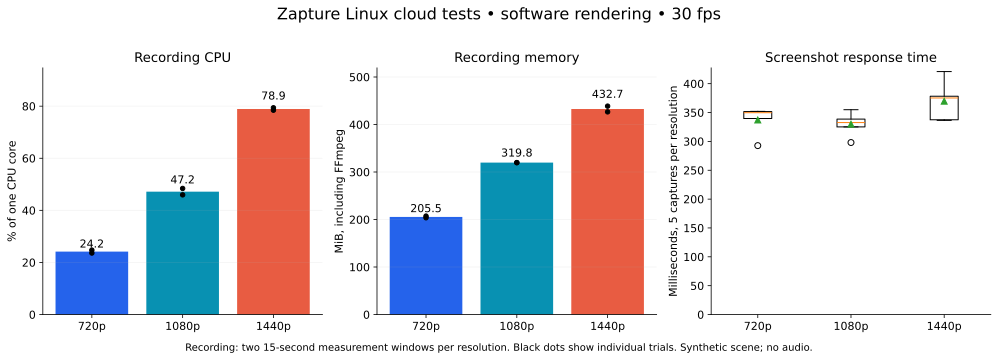
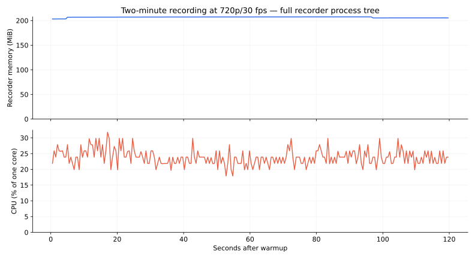

# Extended Linux tests — 15 November 2026

These are functional and performance tests of the released Linux alpha, using a synthetic X11 desktop in a cloud container. They are not Windows results or a competitive ranking.

## What was tested

| Test | Passed | Total |
|---|---:|---:|
| screenshot | 15 | 15 |
| resolution | 6 | 6 |
| repeat-cycle | 5 | 5 |
| sustained | 1 | 1 |

Suite errors: 0. All errors, if any, are retained in the raw JSON.

## Resolution and screenshot tests



| Resolution | Recording CPU (one core) | Recording RAM (RSS) | Screenshot median |
|---|---:|---:|---:|
| 720p | 24.2% | 205.5 MiB | 350 ms |
| 1080p | 47.2% | 319.8 MiB | 333 ms |
| 1440p | 78.9% | 432.7 MiB | 375 ms |

## Sustained recording



The two-minute 720p recording passed decoding and changing-content validation. Median RSS in the first/last ~10 seconds: 206.9/205.5 MiB (difference -1.4 MiB). This short observation cannot rule out a memory leak over hours.

## Method and limits

- Same published 0.1.0-alpha.2 binary and environment as the [earlier benchmark](../linux-cloud-2026-11-15/README.md).
- Screenshots: 5 sequential calls per resolution; timings cover MCP request through saved PNG response, with inline image transfer disabled. Each PNG was fully decoded and its dimensions checked.
- Resolution tests: 2 recordings per resolution; 2-second warmup plus 15-second resource sampling. Full recorder process tree includes FFmpeg. CPU 100% equals one logical core; summed RSS can double-count shared pages.
- Repeat cycles: 5 consecutive 3-second recordings in the same app process, with decoded video and an additional idle stop after each cycle.
- Video validation: ffprobe frame count and dimensions; two decoded sample frames must differ. This detects obvious blank/static output, not every dropped frame or quality defect.
- Sustained test: 120-second measurement after warmup, followed by stop/finalization and validation.
- Resolution order was 720p, 1080p, then 1440p, with no randomized scheduling. Two recording trials per resolution are exploratory, not statistically conclusive.
- The synthetic source expands its desktop and motion range, but element sizes are not all scaled proportionally. Screen content, software rendering and cloud scheduling affect measurements.
- All recording tests use 30 fps, x264 ultrafast CRF 23 and audio off. No quality/fps setting changes, hardware audio tests, GPU tests or desktop OS compatibility claims are made.
- OBS remains excluded because its prior capture produced black frames.

## Run it

Use the [existing package setup](../../../scripts/benchmarks/README.md), then:

```sh
python3 scripts/benchmarks/linux_extended.py --root "$BENCH"
python3 scripts/benchmarks/plot_extended.py "$BENCH/extended-results/results.json" docs/benchmarks/linux-extended-2026-11-15
```

[Raw results](results.json). No production app code was changed.
